# Slide 1: Welcome to Night 1
<div class="pdf-slide-container">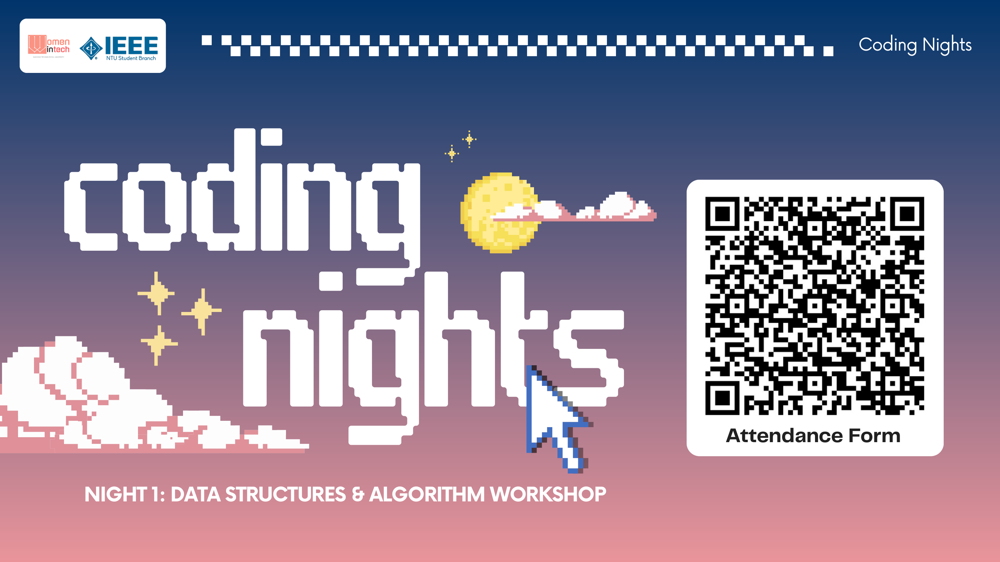</div>
---
[TIMING: 18:40 - 18:42 | 2 MINS]
[STAGE CUE: Greet the room with high energy and warmth. Make direct eye contact with the camera and audience.]

Good evening everyone, and welcome to Night 1 of Coding Nights 3.0! 

Please grab a seat, get your laptops booted up, and make sure you scan that QR code on the screen right away. That logs your attendance so the organizing team can send you tonight's companion Colab notebooks, follow-up challenge problems, and priority sign-ups for the mock interviews.

It is fantastic to see such a packed room here at NTU. Tonight is all about getting your hands dirty with real algorithmic thinking, so get settled in and let's get ready to roll.

# Slide 2: Data Structures & Algorithms Workshop
<div class="pdf-slide-container">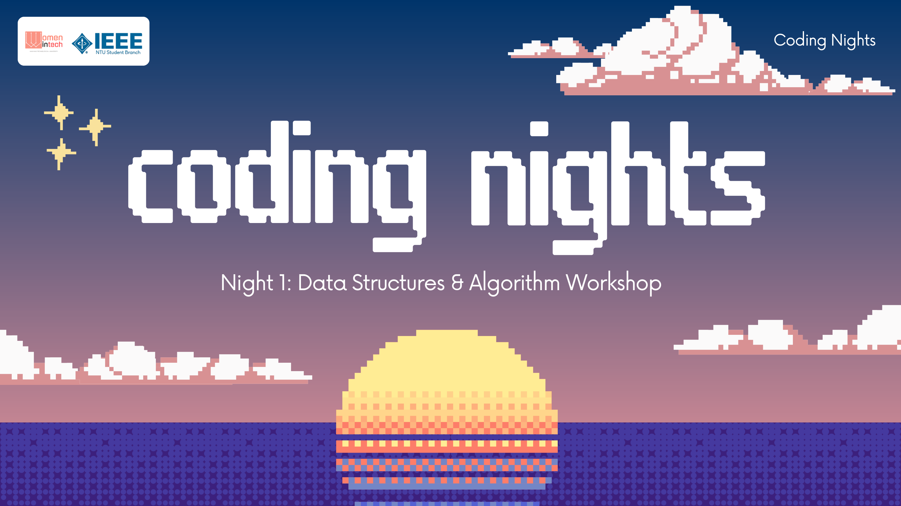</div>
---
[TIMING: 18:42 - 18:43 | 1 MIN]
[STAGE CUE: Set an empowering, reassuring tone.]

We are here tonight to demystify Data Structures and Algorithms once and for all. 

So many developers dread DSA because university courses tend to present it as this dry, intimidating mountain of mathematical proofs. But when you step into an industry interview room, it's not an IQ test—it's a pattern recognition game. 

Over the next two hours, we are going to strip away the panic. We'll build the exact intuition you need so that when you see a problem you've never encountered before, the optimal solution jumps right out at you.

# Slide 3: Attendance Checkpoint
<div class="pdf-slide-container">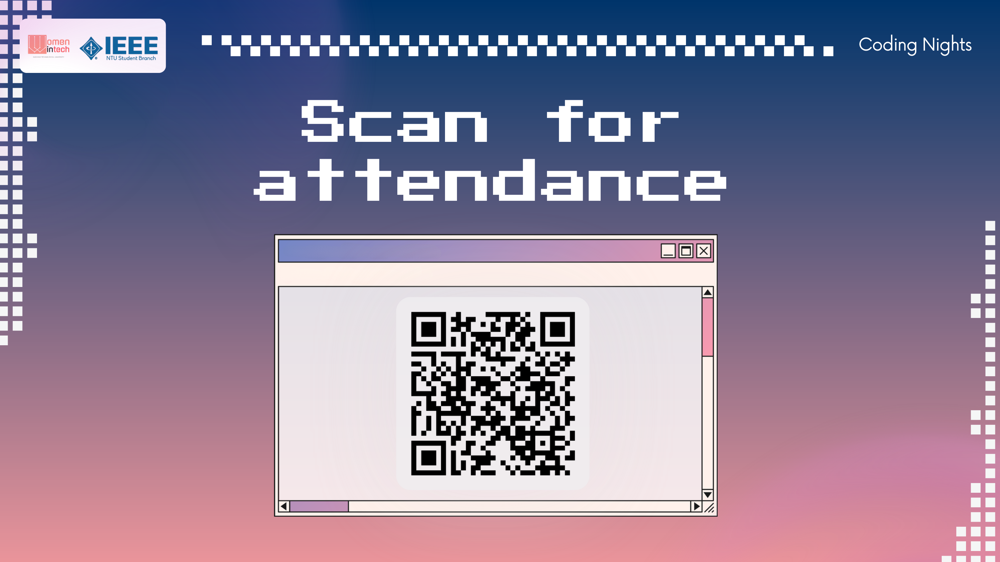</div>
---
[TIMING: 18:43 - 18:44 | 1 MIN]
[STAGE CUE: Brief pause while people point their phones at the screen.]

Here's a full-screen view of that attendance code for anyone who just walked in. 

Take a quick five seconds to point your phone at the screen and get your details submitted. That guarantees you receive the post-session workbook repository, full solutions, and access to our technical coaching in Night 2.

# Slide 4: About WIT @ NTU
<div class="pdf-slide-container">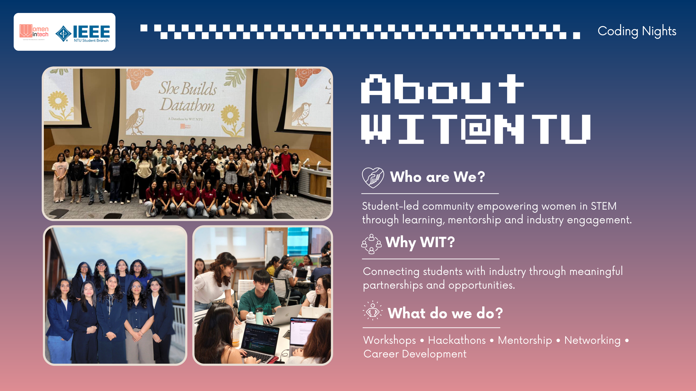</div>
---
[TIMING: 18:44 - 18:45 | 1 MIN]
[STAGE CUE: Speak with genuine appreciation for the student committee.]

Before we talk about computational complexity, I want to give huge credit to the student community that put this entire initiative together: NTU Women In Tech.

WIT @ NTU has been doing extraordinary work building an inclusive, high-impact ecosystem for women and allies across STEM. What makes them special is how they bridge that frustrating gap between what you learn in a lecture hall and what senior engineering managers actually look for when hiring.

# Slide 5: WIT Flagship Initiatives
<div class="pdf-slide-container">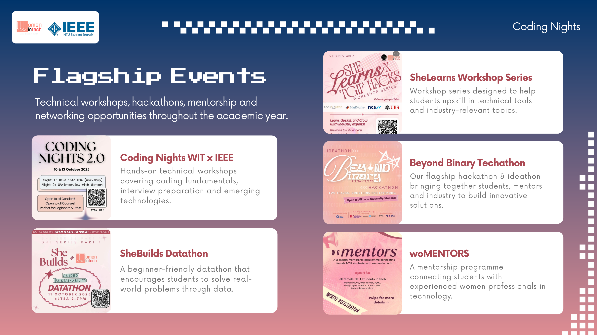</div>
---
[TIMING: 18:45 - 18:46 | 1 MIN]
[STAGE CUE: Glance toward the screen, highlighting the breadth of initiatives.]

You can see their flagship lineup right behind me. Whether you want to compete in datathons like SheBuilds, pick up modern cloud and dev tools in SheLearns, or get paired directly with senior women leaders across tech firms through woMENTORS—this is how you build a real portfolio. 

If you want to accelerate your engineering career before graduation, definitely get involved with this community.

# Slide 6: About IEEE @ NTU
<div class="pdf-slide-container">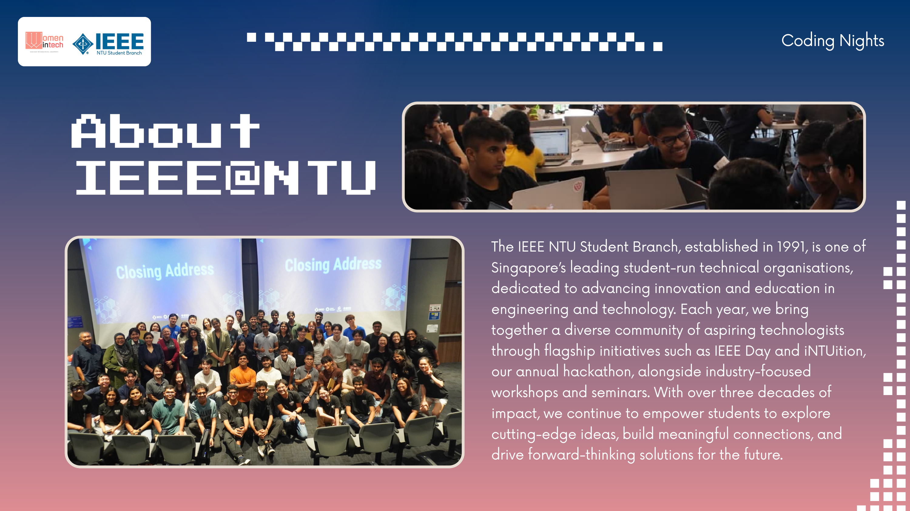</div>
---
[TIMING: 18:46 - 18:47 | 1 MIN]
[STAGE CUE: Acknowledge IEEE Student Branch.]

Co-hosting tonight is the IEEE NTU Student Branch.

IEEE NTU has been an engineering powerhouse here on campus since 1991. For over three decades, they've been spearheading technical masterclasses, university-wide tech initiatives, and iNTUition—one of the premier annual student hackathons in Singapore.

# Slide 7: IEEE Key Initiatives
<div class="pdf-slide-container">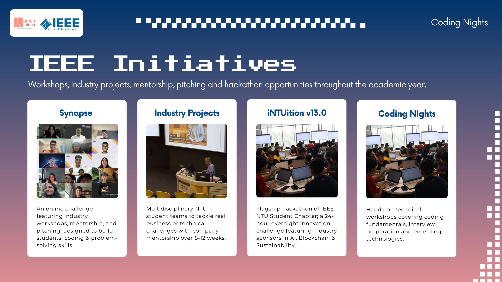</div>
---
[TIMING: 18:47 - 18:48 | 1 MIN]
[STAGE CUE: Highlight the practical industry connection.]

What's really exciting about IEEE's programs is how closely they connect students to real corporate engineering. 

Through their Synapse industry project program, students spend months solving actual engineering problems with company mentors, while iNTUition brings in tier-one industry sponsors. Coding Nights is their dedicated training ground to make sure everyone is sharp and ready to pass technical screens.

# Slide 8: About Coding Nights 3.0
<div class="pdf-slide-container">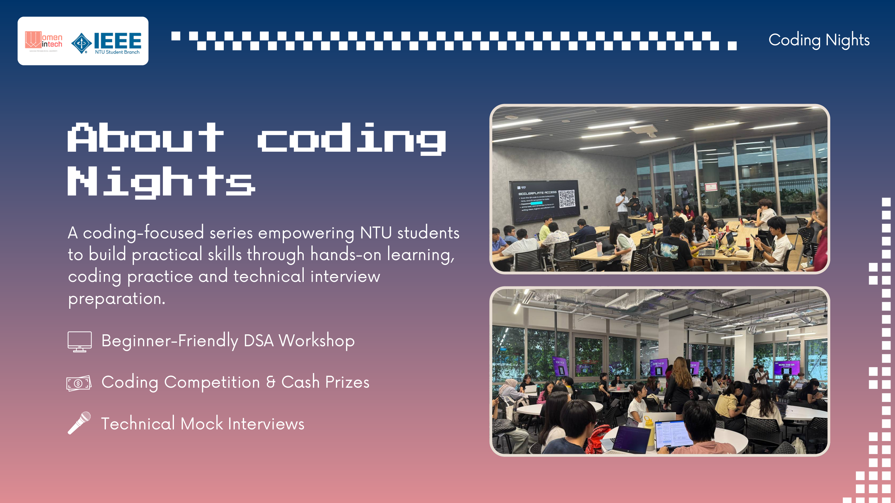</div>
---
[TIMING: 18:48 - 18:49 | 1 MIN]
[STAGE CUE: Frame the 3-part progression.]

So what is the roadmap for Coding Nights 3.0?

Tonight is Part 1: building the mental blueprints and core problem patterns. From here, you'll put those skills to the test in an algorithmic coding competition with cash prizes. And then in Night 2, we simulate the real pressure with authentic 1-on-1 technical mock interviews conducted by experienced software engineers.

# Slide 9: About Your Speaker
<div class="pdf-slide-container">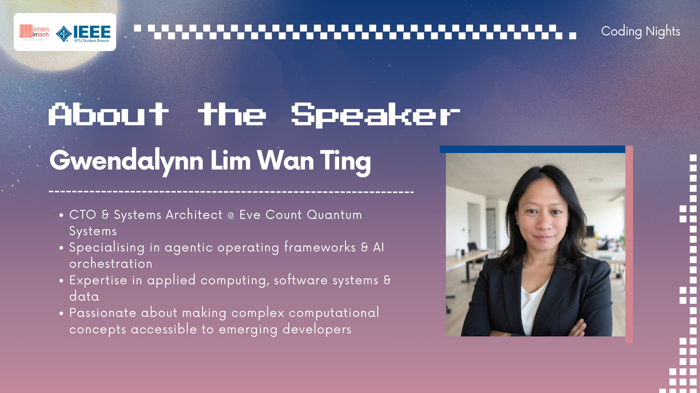</div>
---
[TIMING: 18:49 - 18:50 | 1 MIN]
[STAGE CUE: Speak naturally and warmly about your background.]

A quick word on who I am: My name is Gwendalynn Lim. 

I'm the CTO and Systems Architect at Eve Count Quantum Systems. In my day job, I design agentic operating engines, high-throughput distributed systems, and quantum computational pipelines. 

When your student leads, Rishika and Saba, invited me to lead tonight's masterclass, I jumped at the chance. My goal tonight is simple: take the intimidation out of computational thinking and give you the practical intuition you need to walk into any technical interview with total confidence.

# Slide 10: Event Timeline
<div class="pdf-slide-container">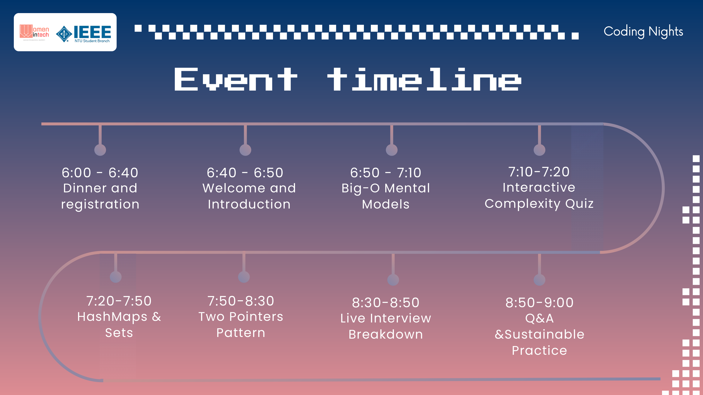</div>
---
[TIMING: 18:50 - 18:52 | 2 MINS]
[STAGE CUE: Walk through the flow of the session without reciting clock times.]

Here's how our evening is structured. 

We'll kick off by rebuilding how you think about Big-O complexity—focusing on growth curves rather than textbook math. Then we'll do a quick live Kahoot check to test your instincts. 

After that, we'll dive deep into the two most critical patterns for array and string interviews: HashMaps for constant-time lookups, and Two Pointers with Sliding Windows for in-place manipulation. We'll close with our five-step framework for deconstructing unseen interview problems. Let's dive in!

# Slide 11: Technical Workshop Begins
<div class="pdf-slide-container">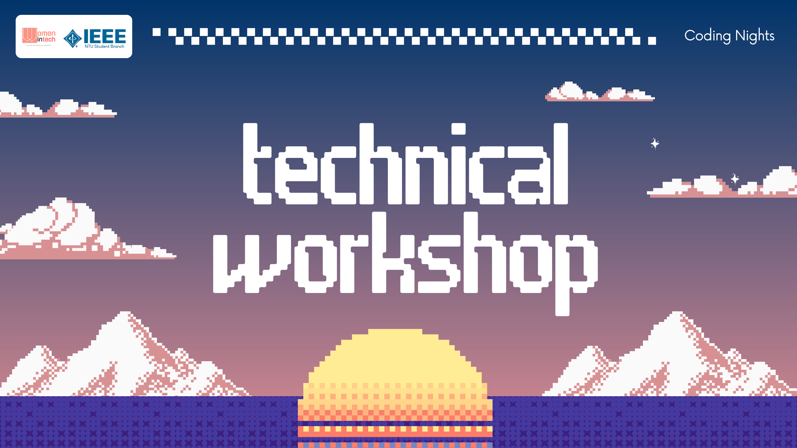</div>
---
[TIMING: 18:52 - 18:53 | 1 MIN]
[STAGE CUE: Energy shifts into high gear. Authoritative, inspiring.]

We are now officially in workshop mode. 

From this moment on, forget about memorizing answers for an exam. Start thinking like a software engineer designing resilient, scalable algorithms that won't fall apart when production traffic explodes.

# Slide 12: What You Will Learn Tonight
<div class="pdf-slide-container">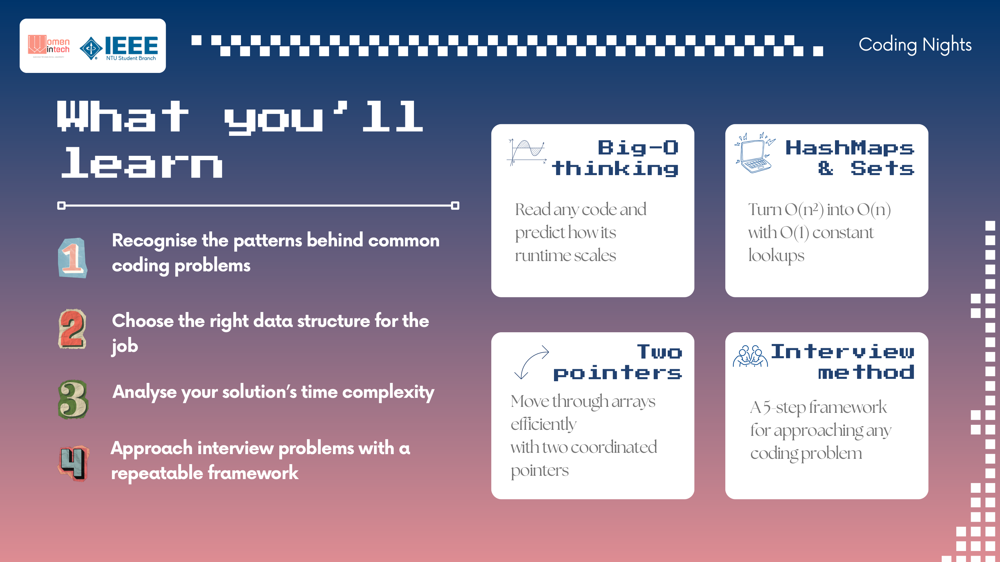</div>
---
[TIMING: 18:53 - 18:55 | 2 MINS]
[STAGE CUE: Emphasize the four takeaways as superpowers.]

Here is what you're walking away with tonight. 

You're going to look at any snippet of code and immediately see its scaling envelope. You're going to learn how to turn terrible nested loops into lightning-fast single-pass routines. You'll master navigating linear data structures with zero auxiliary memory. 

And most importantly, you'll have a repeatable strategy to tackle any unfamiliar problem an interviewer throws across the table.

# Slide 13: Why Complexity Matters
<div class="pdf-slide-container">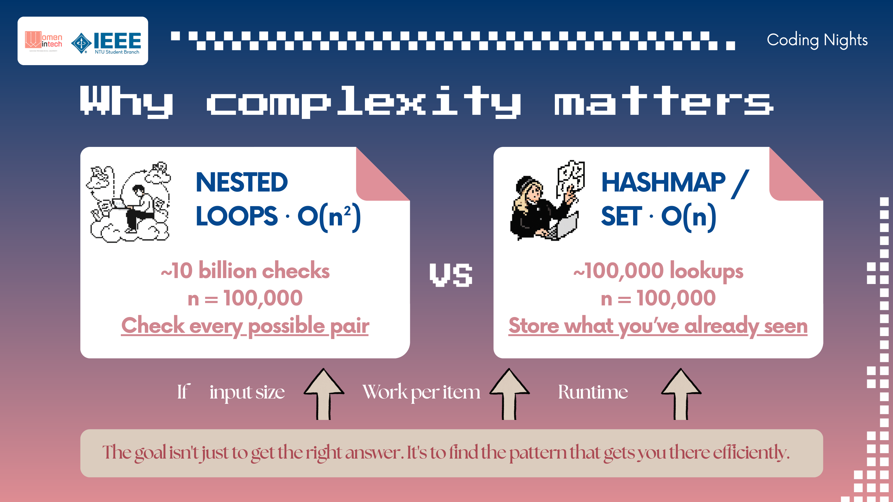</div>
---
[TIMING: 18:55 - 19:00 | 5 MINS]
[STAGE CUE: Emphasize the dramatic gap between the two sides of the slide.]

Look at the contrast on this slide—this is the entire reason algorithmic engineering exists.

Imagine an array of just a hundred thousand elements. That is a tiny dataset in modern software. If you write a brute-force nested loop checking every pair, your CPU has to chew through ten billion operations. That will freeze your thread, time out your test suite, and crash your server.

Now look at the right side: by using a Hash Table, you do one single pass. That's about a hundred thousand instant checks—done in ten milliseconds! That's the difference between software that collapses under load and software that scales effortlessly.

# Slide 14: Big-O: Think Growth Rate, Not Speed
<div class="pdf-slide-container">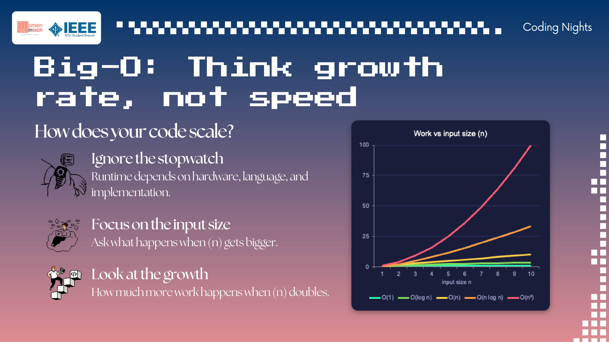</div>
---
[TIMING: 19:00 - 19:05 | 5 MINS]
[STAGE CUE: Make a throwing gesture for 'throw away the stopwatch'.]

Rule number one of complexity analysis: throw away the stopwatch. 

Timing your Python script with a clock doesn't tell you anything meaningful. Wall-clock runtime changes depending on whether your laptop is plugged in, what background apps are running, or how the interpreter optimizes bytecode.

In computer science, we ask a fundamentally different question: What happens to the workload when the input doubles? If doubling the data doubles the work, you're linear. If it quadruples the work, you're quadratic. If it barely adds a single step, you're logarithmic. Big-O isn't speed—it's the rate of growth.

# Slide 15: Common Complexity Classes at a Glance
<div class="pdf-slide-container">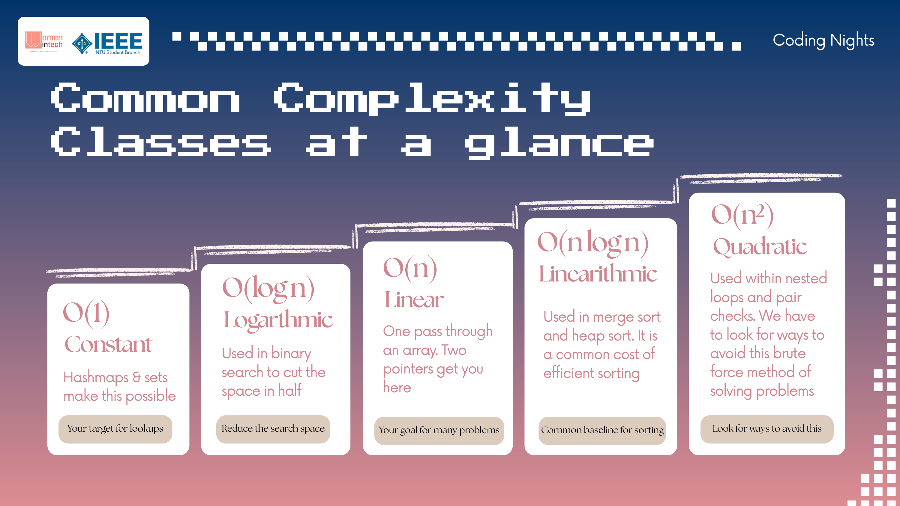</div>
---
[TIMING: 19:05 - 19:10 | 5 MINS]
[STAGE CUE: Group the complexities into intuition buckets.]

Here are the five tiers you'll see in almost every coding interview. 

Constant and logarithmic time are your gold standards—that's binary search and hash lookups. Linear time is your dependable baseline: you touch every element once. 

Log-linear is the universal ceiling for comparison sorting. And quadratic time—those nested loops—is your warning sign. In an interview, quadratic is fine to mention as brute force, but you never leave it as your final answer.

# Slide 16: Time vs. Space: The Core Trade-Off
<div class="pdf-slide-container">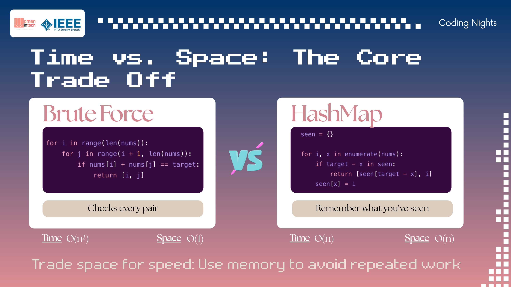</div>
---
[TIMING: 19:10 - 19:15 | 5 MINS]
[STAGE CUE: Weigh hands like a scale: CPU cycles vs RAM.]

This brings us to the fundamental trade-off of computing: Space versus Time.

Brute force uses almost no memory because it refuses to remember anything—forcing your CPU to recalculate the same checks over and over. A HashMap does the opposite: it consumes a little memory to remember what it has already seen, saving thousands of CPU cycles.

In modern engineering, RAM is plentiful, but CPU time and user latency are precious. When an algorithm is too slow, trade memory for speed. Remember past work so you never have to repeat it.

# Slide 17: Interactive Kahoot Quiz
<div class="pdf-slide-container"></div>
---
[TIMING: 19:15 - 19:20 | 5 MINS]
[STAGE CUE: Banter with the room, encourage everyone to jump in.]

Let's see how sharp your intuition is! Time for a quick Kahoot challenge.

Pull out your phones or open a new browser tab, enter the game PIN on the screen, and pick your nickname. Let's see who can spot the time complexity bottlenecks the fastest. There are spot prizes for our top scorers tonight, so let's get after it!

[INTERACTION: Host the 5-minute Kahoot quiz, commenting on common complexity traps.]

# Slide 18: HashMaps & Sets: The O(1) Trick
<div class="pdf-slide-container">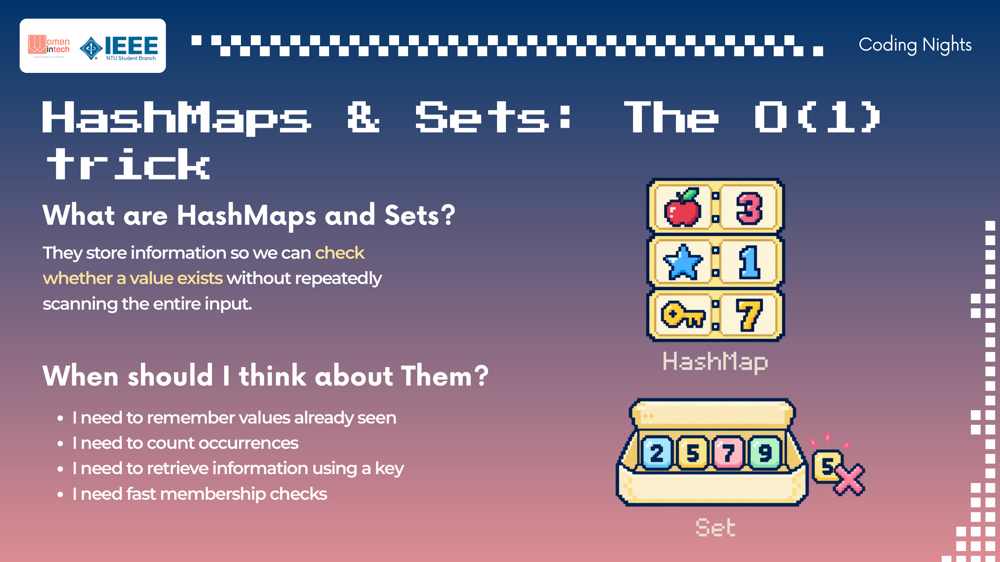</div>
---
[TIMING: 19:20 - 19:25 | 5 MINS]
[STAGE CUE: Transition into Pattern 1. Lean in with enthusiasm.]

Let's dive into Pattern Number 1: HashMaps and Sets. 

Think of a Hash Table as an instant memory lookup card. Instead of searching through an entire warehouse every time you need an item, you calculate an address directly and fetch it immediately.

Whenever an interview problem requires you to remember items you've already visited, count how often something appears, or verify membership in constant time, your immediate instinct should be a Hash Table.

# Slide 19: Pattern: Frequency Counter
<div class="pdf-slide-container">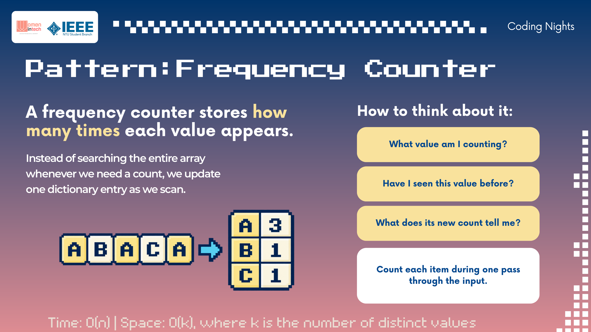</div>
---
[TIMING: 19:25 - 19:30 | 5 MINS]
[STAGE CUE: Focus on the design pattern, not the raw syntax.]

Our first sub-pattern is the Frequency Counter. 

The beauty here is simplicity: as you stream through your data, you tally occurrences inside a dictionary on the fly. You touch each item once, giving you strict linear time.

Instead of writing a nested search loop later, you can inspect your dictionary and immediately answer questions about majorities, anagrams, or duplicates in constant time per key.

# Slide 20: Problem 1.1 — Contains Duplicate
<div class="pdf-slide-container">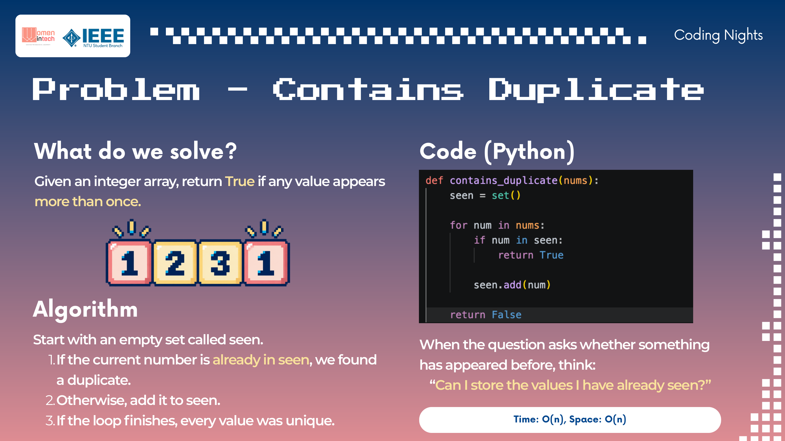</div>

```python
def contains_duplicate(nums: list[int]) -> bool:
    seen = set()
    for num in nums:
        if num in seen:
            return True  # Found duplicate in O(1)
        seen.add(num)
    return False

# Time: O(n) | Space: O(n)
```
---
[TIMING: 19:30 - 19:35 | 5 MINS]
[STAGE CUE: Explain the strategy on screen without reading code lines aloud.]

Look at how cleanly this translates into code for Contains Duplicate.

If you are new to Hash Sets, don't overcomplicate it. Imagine you are a bouncer at a very exclusive club. You have a clipboard. 

As a line of people (our array of numbers) walks up to the door one by one, you don't run inside the club to see if someone with their exact face is already in there—that would take forever. Instead, you just look at your clipboard. 

You ask: *"Are you already on my list?"* 
If they aren't, you write their name down (that's `seen.add(num)`) and let them in.
If they *are* already on your list, you immediately raise the alarm (that's returning `True`). 

You traded a little bit of space (the physical clipboard) so you never have to waste time running around the club. That is all a Set is!

# Slide 21: Pattern: Complement Lookup
<div class="pdf-slide-container">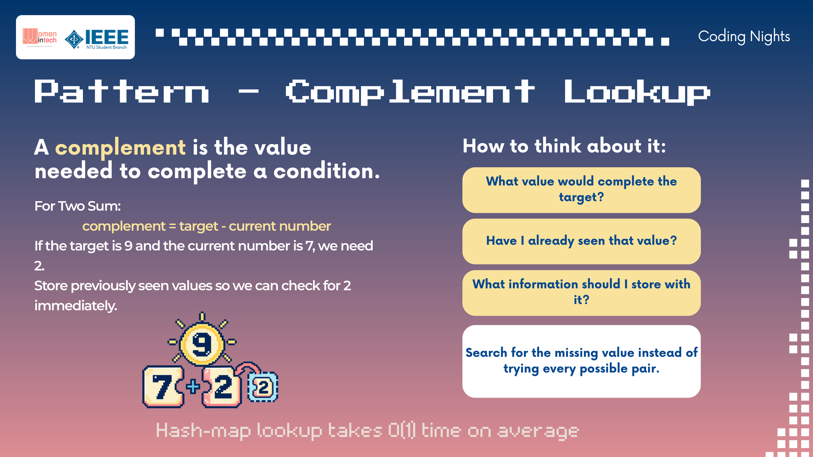</div>
---
[TIMING: 19:35 - 19:40 | 5 MINS]
[STAGE CUE: Highlight the mathematical insight.]

Now let's examine one of the most famous patterns in technical interviews: The Complement Lookup.

Here's the mental shift: if your target sum is 9, and your current element is 7, you don't need to wander through the array looking at every other number. You only care about finding one specific partner: the number 2.

Instead of scanning all pairs, you calculate the exact missing piece and ask your dictionary if that partner has already been stored. That turns an exhaustive search into an instant memory check.

# Slide 22: Problem 1.2 — Two Sum
<div class="pdf-slide-container">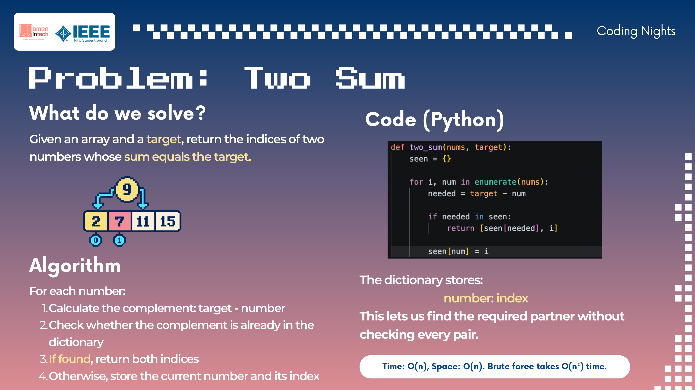</div>

```python
def two_sum(nums: list[int], target: int) -> list[int]:
    prev_map = {}  # value -> original index
    for i, num in enumerate(nums):
        complement = target - num
        if complement in prev_map:
            return [prev_map[complement], i]
        prev_map[num] = i
    return []

# Time: O(n) | Space: O(n)
```
---
[TIMING: 19:40 - 19:50 | 10 MINS]
[STAGE CUE: Explain the crucial trap: checking before inserting.]

Here is the implementation of Two Sum, and notice the subtle detail that trips up so many junior candidates.

Why do we check `complement in prev_map` before storing the current number? Because the prompt says you cannot use the same element twice! If the target is 6 and your current number is 3, inserting first would let 3 match with itself! 

Checking first guarantees that any matching partner was genuinely discovered in an earlier iteration. In one single pass, you find the pair in linear time.

# Slide 22.5: Interactive Kahoot Quiz (HashMaps & Sets)
---
[TIMING: 19:50 - 20:00 | 10 MINS]
[STAGE CUE: Transition to the second Kahoot checkpoint.]

Alright, you've seen how powerful $O(1)$ constant time lookup can be. Let's see if you can spot when to use it! 

Get your phones back out—we're jumping into our second Kahoot checkpoint. This one is entirely focused on HashMaps, Sets, and spotting the right scenarios to use them. Let's see who takes the lead.

[INTERACTION: Host the 10-minute Kahoot quiz on HashMaps & Sets.]

# Slide 23: Two Pointers: When & Why
<div class="pdf-slide-container">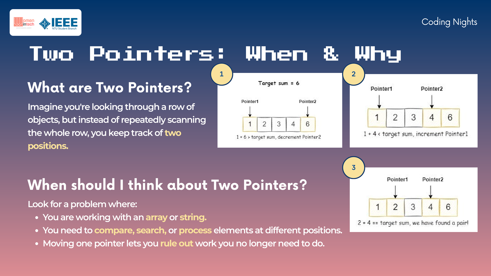</div>
---
[TIMING: 19:50 - 19:55 | 5 MINS]
[STAGE CUE: Pivot to space optimization.]

HashMaps are fantastic, but they have a cost: they consume memory. What happens when an interviewer challenges you: "Can you solve this with zero extra memory?"

That is where Two Pointers comes in. Instead of creating external lookup tables, we coordinate two index positions directly on the sequence itself. By moving pointers strategically, we permanently rule out subsets of work without allocating a single extra byte of RAM.

# Slide 24: Pattern: Converging Pointers
<div class="pdf-slide-container">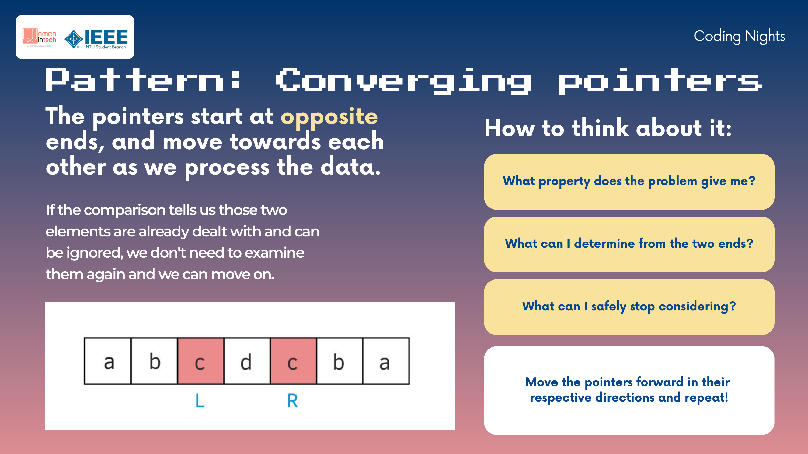</div>
---
[TIMING: 19:55 - 20:00 | 5 MINS]
[STAGE CUE: Bring hands together to demonstrate the inward squeeze.]

The most intuitive pointer setup is Converging Pointers.

You place one pointer at the start and the other at the end. At each step, you evaluate the outer boundaries. Once you confirm their status, you squeeze inward. You never need to look at those outer elements again.

This works brilliantly whenever a problem exhibits symmetry or sorted monotonicity, allowing you to cut the search space from both sides simultaneously.

# Slide 25: Problem 2.1 — Valid Palindrome
<div class="pdf-slide-container">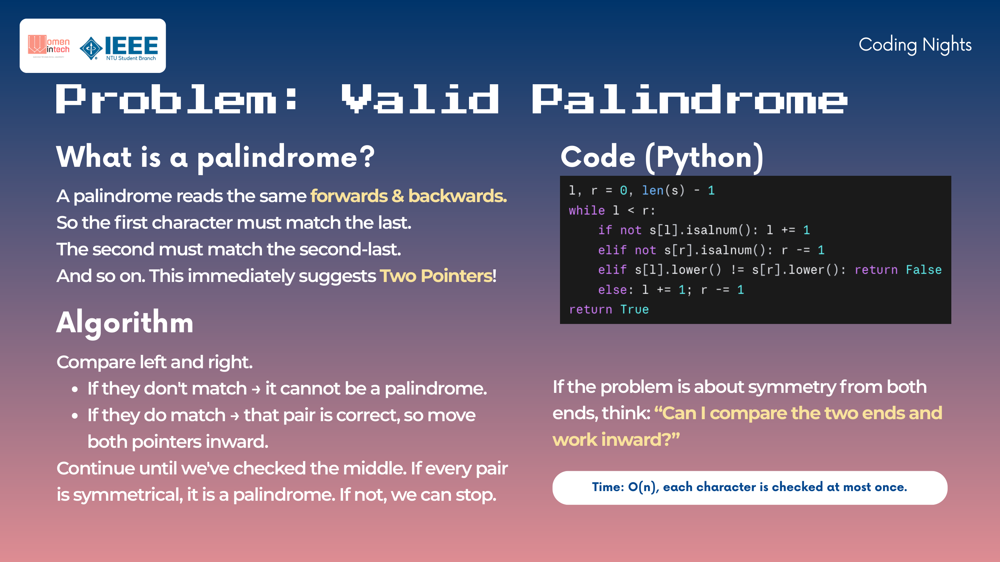</div>

```python
def is_palindrome(s: str) -> bool:
    left, right = 0, len(s) - 1
    while left < right:
        while left < right and not s[left].isalnum():
            left += 1
        while left < right and not s[right].isalnum():
            right -= 1
        if s[left].lower() != s[right].lower():
            return False
        left += 1
        right -= 1
    return True

# Time: O(n) | Space: O(1)
```
---
[TIMING: 20:00 - 20:08 | 8 MINS]
[STAGE CUE: Highlight the in-place efficiency over string copying.]

Look at how this solves Valid Palindrome.

A common beginner mistake is allocating a brand-new cleaned string with `"".join(...)` and reversing it. That burns extra memory. 

With two pointers, we do it completely in-place. The pointers step past non-alphanumeric punctuation from both ends. When both point to valid characters, we compare. If they match, we squeeze inward. Notice how the inner while loops are guarded by `left < right`—that protects you from out-of-bounds errors on edge cases.

# Slide 26: Pattern: Sliding Window
<div class="pdf-slide-container">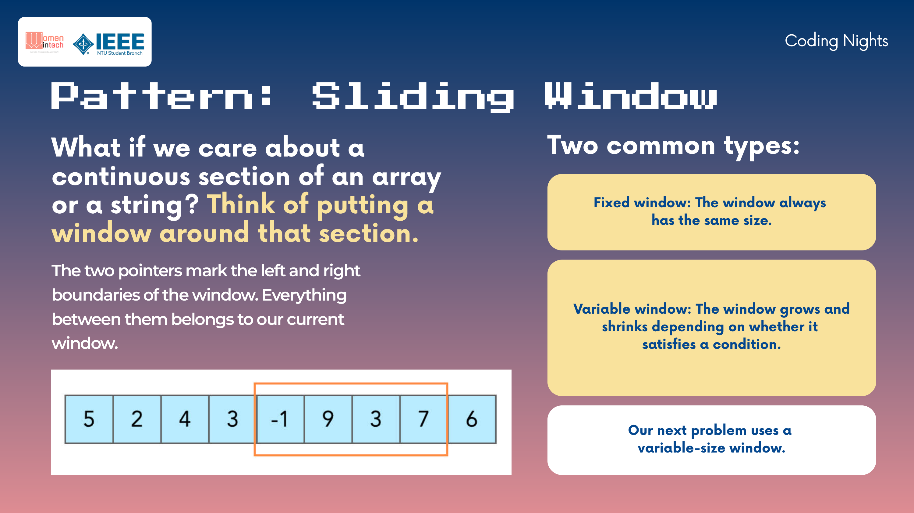</div>
---
[TIMING: 20:08 - 20:13 | 5 MINS]
[STAGE CUE: Describe an accordion expanding and contracting.]

Now let's examine our next superpower: The Sliding Window.

Whenever an interview problem asks about continuous subarrays or substrings, visualize an adjustable window placed over the data. The two pointers form the left and right boundaries of that window.

In a variable sliding window, you stretch the right edge forward to ingest new elements. The moment a constraint is violated, you gently pull the left edge inward until the window becomes valid again.

# Slide 27: Problem 2.2 — Longest Substring Without Repeats
<div class="pdf-slide-container">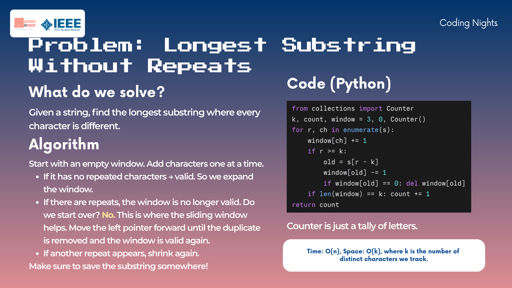</div>

```python
def length_of_longest_substring(s: str) -> int:
    char_set = set()
    left = 0
    max_len = 0
    for right in range(len(s)):
        while s[right] in char_set:
            char_set.remove(s[left])
            left += 1
        char_set.add(s[right])
        max_len = max(max_len, right - left + 1)
    return max_len

# Time: O(n) | Space: O(min(n, m))
```
---
[TIMING: 20:13 - 20:20 | 7 MINS]
[STAGE CUE: Emphasize the beauty of evicting from the left rather than starting over.]

Here is the famous Longest Substring Without Repeating Characters.

Watch the window dynamics on screen. We expand with our `right` pointer, adding characters to our set. But what happens when we hit a duplicate? We don't discard our work and start from scratch! 

We simply evict characters from the `left` edge until the offending duplicate is removed. Because every character is added once and removed at most once, this runs in strictly linear time.

# Slide 28: Pattern: In-Place Manipulation
<div class="pdf-slide-container">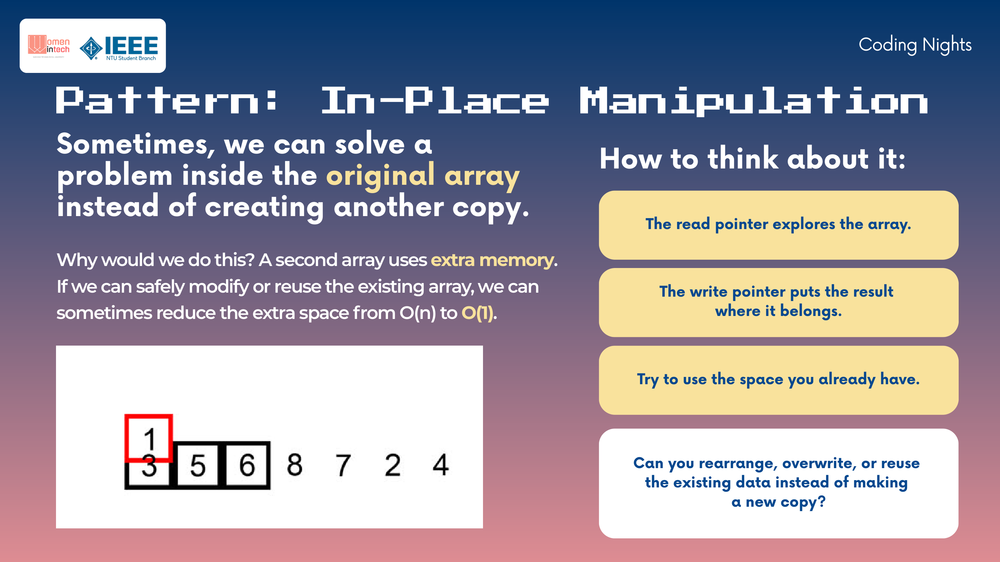</div>
---
[TIMING: 20:20 - 20:23 | 3 MINS]
[STAGE CUE: Contrast the Read pointer scouting ahead with the Write pointer following behind.]

Our third pointer concept is In-Place Manipulation.

Think of this as having two distinct roles: a Read pointer that scouts ahead inspecting incoming elements, and a Write pointer that records valid results into the array behind it.

By overwriting memory you've already inspected, you can deduplicate or filter an array without creating a second copy, keeping auxiliary memory strictly constant.

# Slide 29: Problem 2.3 — Two Sum II (Sorted Array)
<div class="pdf-slide-container">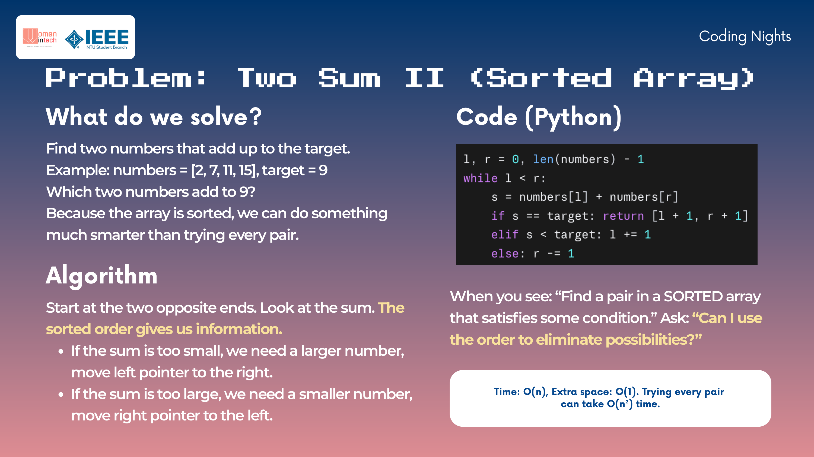</div>

```python
def two_sum_sorted(numbers: list[int], target: int) -> list[int]:
    left, right = 0, len(numbers) - 1
    while left < right:
        current_sum = numbers[left] + numbers[right]
        if current_sum == target:
            return [left + 1, right + 1]  # 1-indexed output
        elif current_sum < target:
            left += 1   # Sum too small -> increment left
        else:
            right -= 1  # Sum too large -> decrement right
    return []

# Time: O(n) | Space: O(1)
```
---
[TIMING: 20:23 - 20:30 | 7 MINS]
[STAGE CUE: Contrast this with Slide 22 Two Sum.]

Now compare this to the Two Sum we solved earlier with a HashMap.

Notice the crucial difference: this array is already sorted! That sorted order gives us directional certainty. If our current sum is smaller than the target, the only way to increase it is to step our `left` pointer forward. If it's too big, we step `right` backward.

We achieved the exact same linear time as a HashMap, but dropped auxiliary space to $O(1)$. Always look for sorted order—it's your cue to save memory.

# Slide 29.5: Interactive Kahoot Quiz (Two Pointers)
---
[TIMING: 20:30 - 20:40 | 10 MINS]
[STAGE CUE: Keep energy high for the final interactive segment.]

Before we move on to how you handle the actual interview room, we have one final Kahoot checkpoint!

You just learned how to squeeze arrays from both sides and slide windows across them without using extra memory. Let's lock that intuition in. Bring up your phones for our final interactive quiz on Two Pointers!

[INTERACTION: Host the 10-minute Kahoot quiz on Two Pointers.]

# Slide 30: Live Technical Interview Breakdown
<div class="pdf-slide-container">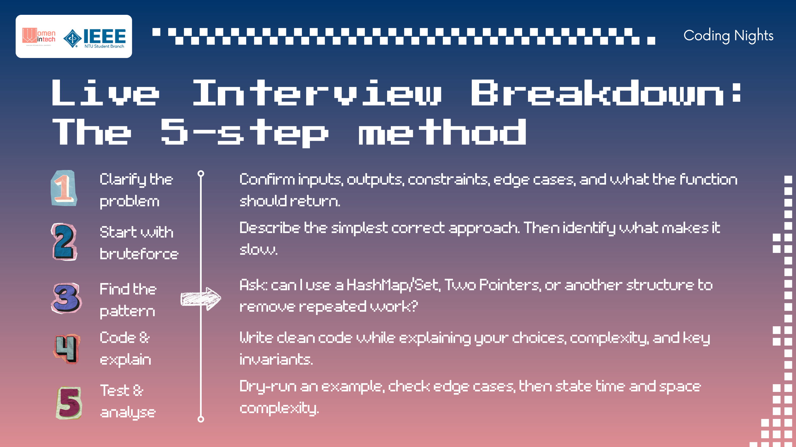</div>
---
[TIMING: 20:30 - 20:45 | 15 MINS]
[STAGE CUE: Speak with senior engineering authority. High-value career advice.]

Now let's talk about how you actually execute in the interview room.

The single biggest mistake candidates make is immediately typing code. Don't do that. Interviewers want to see how you dissect ambiguity. 

Start by clarifying constraints and edge cases: "Can inputs be empty? Are there negative numbers?" Then vocalize the brute-force approach first—it proves you understand the baseline problem and sets up your optimization. Once you identify the pattern, outline your approach, write clean modular code, and dry-run a concrete test case before declaring you're done.

# Slide 31: Practice Roadmap: NeetCode 75
<div class="pdf-slide-container">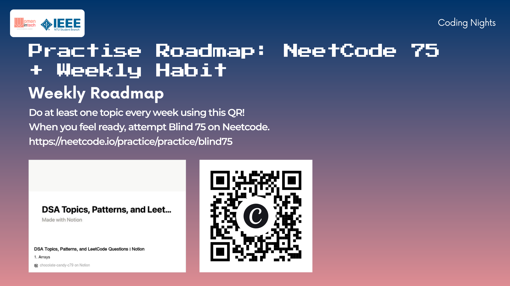</div>
---
[TIMING: 20:45 - 20:50 | 5 MINS]
[STAGE CUE: Point to the QR code on screen.]

How do you take what you learned tonight and make it stick?

Please, do not blindly grind five hundred random LeetCode problems. That's a direct path to burnout. Instead, follow a curated, pattern-based curriculum like NeetCode 75 or Blind 75.

Scan that QR code on the screen. Dedicate one week to HashMaps, one week to Two Pointers, one week to Sliding Windows. When you master the archetype patterns, you can solve dozens of variations with ease.

# Slide 32: Open Q&A Session
<div class="pdf-slide-container">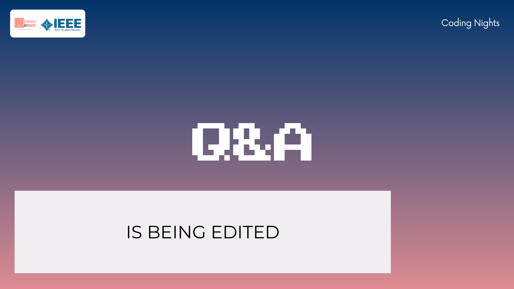</div>
---
[TIMING: 20:50 - 20:54 | 4 MINS]
[STAGE CUE: Open up the room with a welcoming smile.]

We have covered a tremendous amount of ground tonight—from Big-O intuition to HashMaps, converging pointers, and sliding windows.

I want to open up the room for questions. Ask about any of the code patterns, how to deal with interview anxiety, or what real technical evaluations look like. What's on your mind?

[INTERACTION: Take 2-3 audience questions from the lecture hall.]

# Slide 33: End of Night 1
<div class="pdf-slide-container">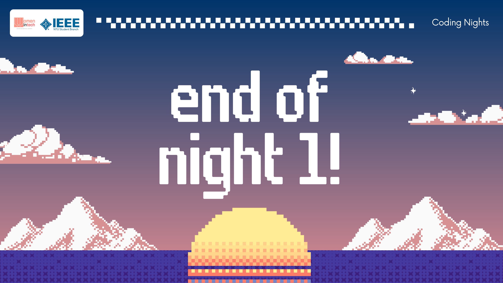</div>
---
[TIMING: 20:54 - 20:55 | 1 MIN]
[STAGE CUE: Lead warm applause for the attendees.]

And that brings our technical workshop for Night 1 to a close! 

Give yourselves a huge round of applause for putting in the work tonight. You now possess the foundational mental models to deconstruct over 40% of standard array and string interview questions.

# Slide 34: Token of Gratitude
<div class="pdf-slide-container">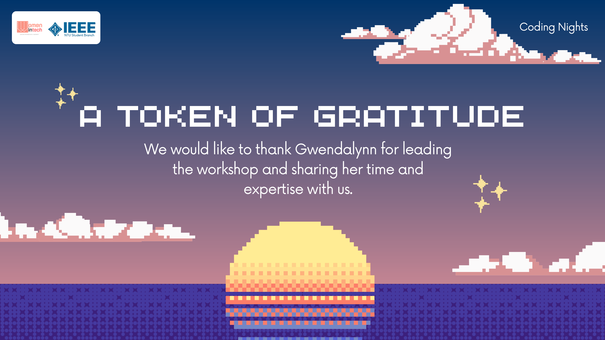</div>
---
[TIMING: 20:55 - 20:56 | 1 MIN]
[STAGE CUE: Graciously acknowledge the student committee.]

A heartfelt thank you to the organizing committee—Rishika, Saba, and the entire team across NTU Women In Tech and IEEE NTU Student Branch. 

Putting together an event of this scale takes serious dedication, and it has been an honor sharing tonight with all of you.

# Slide 35: Group Photo
<div class="pdf-slide-container">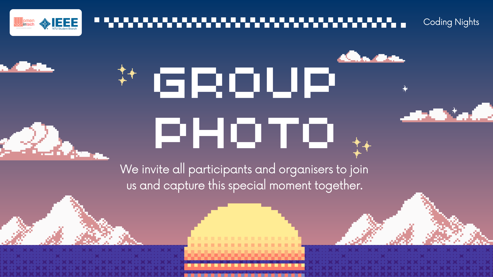</div>
---
[TIMING: 20:56 - 20:57 | 1 MIN]
[STAGE CUE: Invite everyone forward for the commemorative photo.]

Before anyone leaves, let's capture this evening together! 

I invite all participants and organizers to come up front for our official Coding Nights 3.0 group photo. Everyone squeeze in close!

# Slide 36: Night 2 Preview
<div class="pdf-slide-container">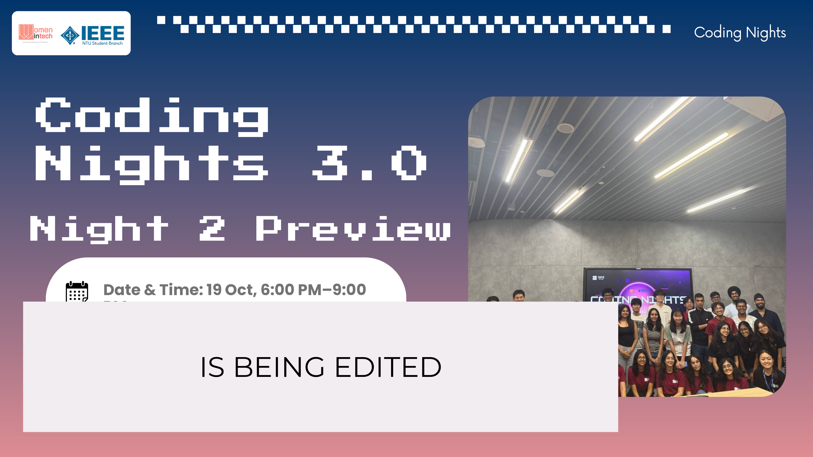</div>
---
[TIMING: 20:57 - 20:58 | 1 MIN]
[STAGE CUE: Build excitement for the upcoming mock interviews.]

Mark your calendars for Night 2: Sunday, October 19th!

If tonight was the flight manual, Night 2 is the flight simulator. You'll sit through an authentic, timed Online Assessment under exam conditions, followed by 1-on-1 mock technical interviews with industry software engineers. It's the best interview preparation you can get on campus, so do not miss it.

# Slide 37: Feedback Form
<div class="pdf-slide-container">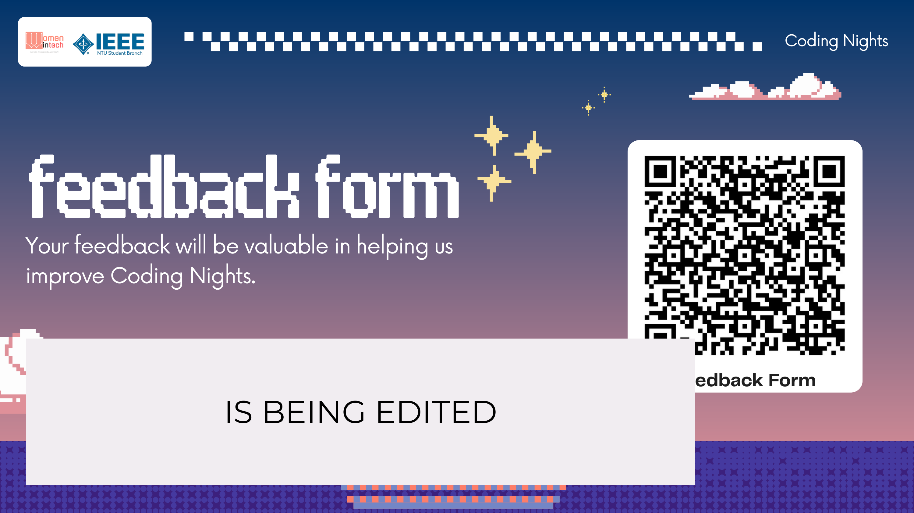</div>
---
[TIMING: 20:58 - 20:59 | 1 MIN]
[STAGE CUE: Encourage candid feedback.]

Please take thirty seconds to scan the feedback code on screen. 

Your feedback directly shapes future student workshops and helps our student chapters continue delivering top-tier technical training to the NTU community.

# Slide 38: Attendance & Social Links
<div class="pdf-slide-container">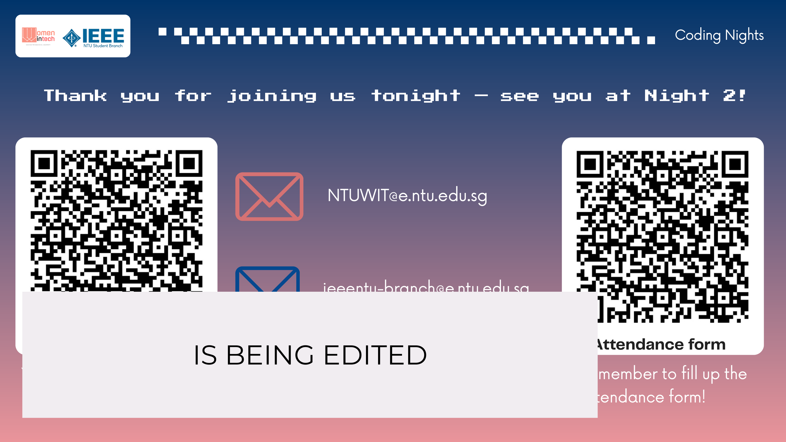</div>
---
[TIMING: 20:59 - 21:00 | 1 MIN]
[STAGE CUE: Final administrative reminder.]

If you missed the initial attendance form at the start of the session, please scan this code now so your attendance is recorded. 

You can also reach out to the organizing teams at the emails on screen if you have any questions about the upcoming competition or Night 2.

# Slide 39: Thank You!
<div class="pdf-slide-container">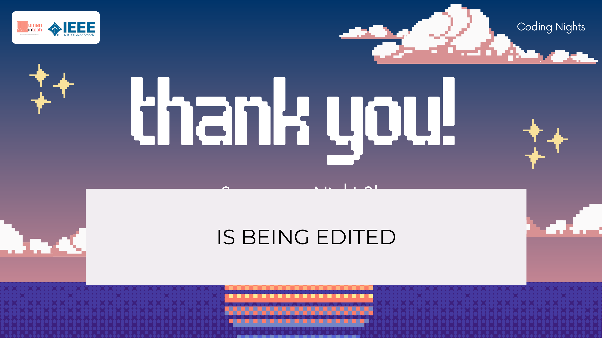</div>
---
[TIMING: 21:00 | FINAL SIGN-OFF]
[STAGE CUE: Warm smile, wave to audience and camera.]

Thank you all so much for coming out to Coding Nights 3.0: Night 1! 

Remember: Algorithms aren't magic. They're just structured logic waiting to be recognized. Practice with intention, build your patterns, check out our companion GitHub repo, and I will see you all for Night 2 on October 19th! Goodnight!
